# Evidencia de la Práctica

**Alumno:** [Jesus Omar Mendez] · **Grupo:** [GTID243]
**Materia:** [materia] · **Profesor:** Anastacio Rodríguez García

## Pruebas Unitarias (`flutter test`)

### Ronda 1a: Formatear pesos

Rojo:

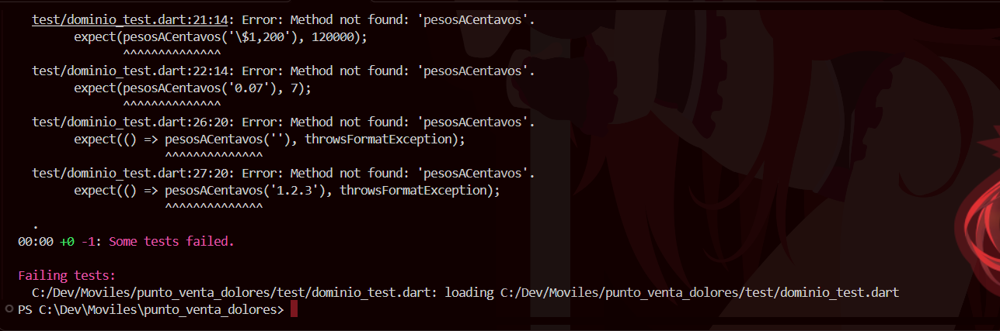

Verde:

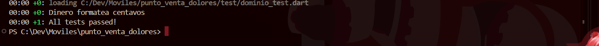

### Ronda 1b: Texto a centavos

Rojo:

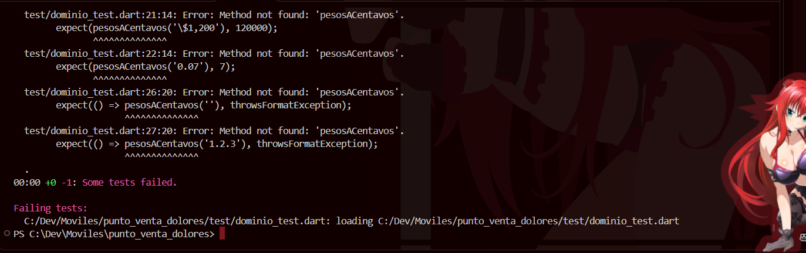

Verde:

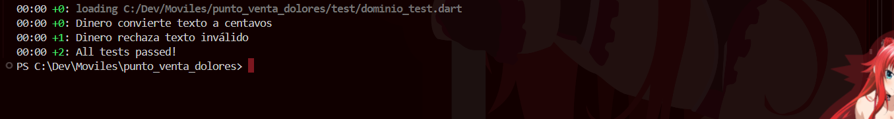

### Ronda 2: Producto

Rojo:

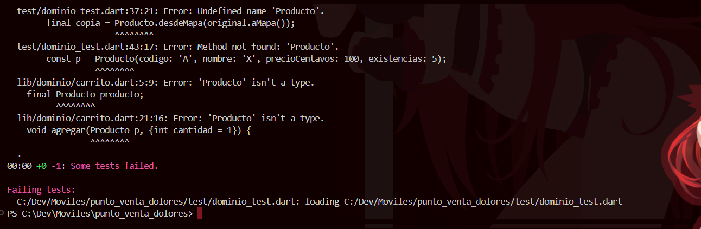

Verde:

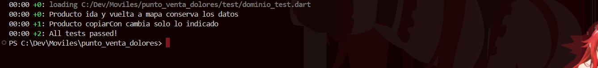

### Ronda 3a: Sumar cantidades en el carrito

Rojo:

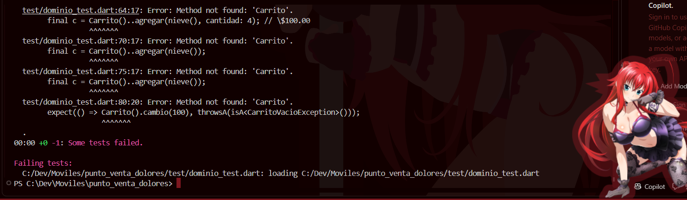

Verde:

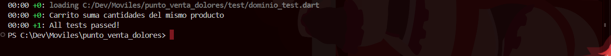

### Ronda 3b: No exceder existencias

Rojo:

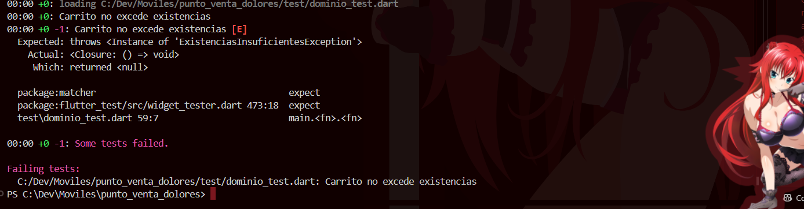

Verde:

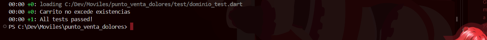

### Ronda 3c: IVA incluido

Rojo:

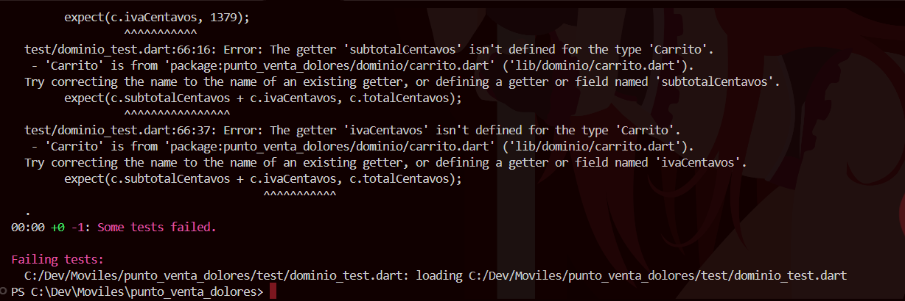

Verde:

### Ronda 3d: Cambio, pago corto y carrito vacío

Rojo:

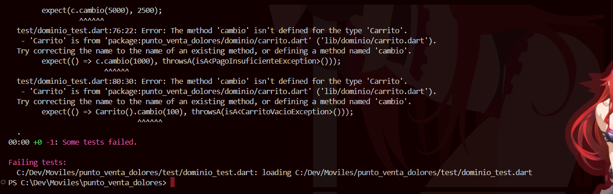

Verde:

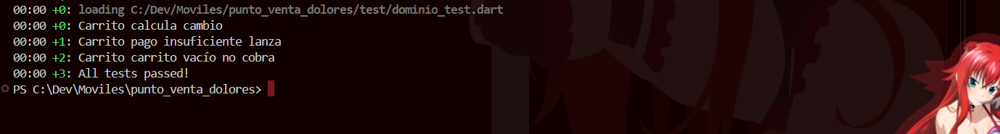

### Ronda 4: Guardar y buscar productos (SQLite)

Rojo:

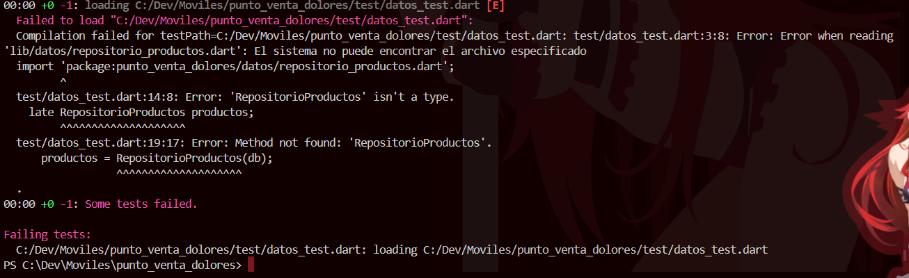

Verde:

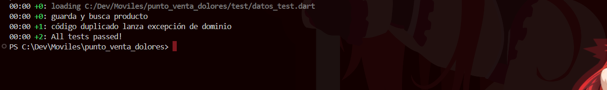

### Ronda 5a: Cobrar descuenta inventario

Rojo:

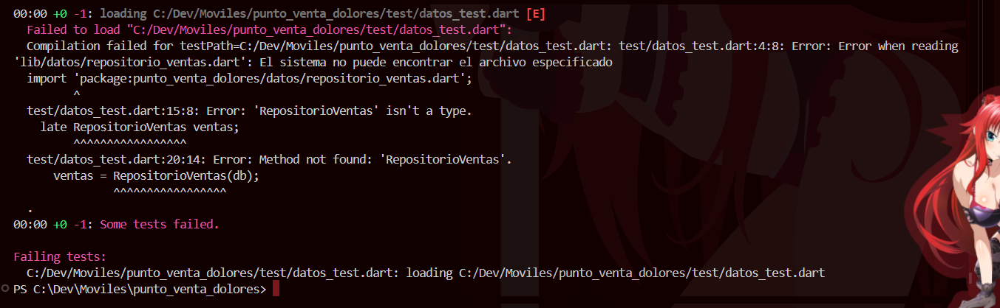

Verde:

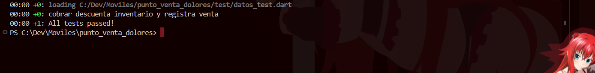

### Ronda 5b: Si falla el cobro no se descuenta inventario

Sin rojo: según el manual, esta prueba pasa de inmediato.

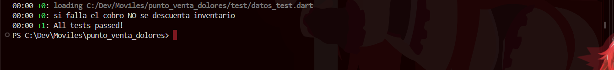

### Ronda 5c: Corte del día y bajo inventario

Rojo:

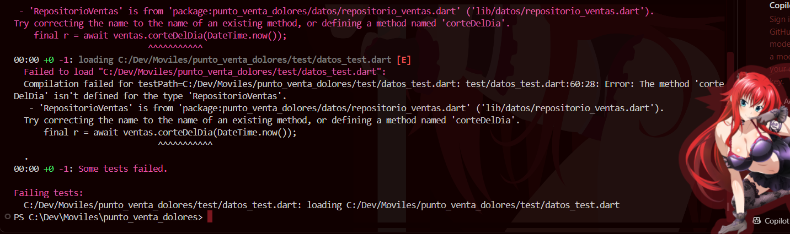

Verde:

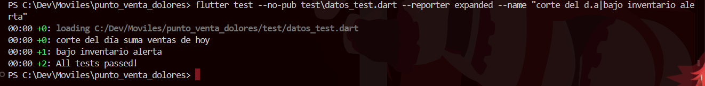

### Resultado final

Ejecución completa de todas las pruebas:

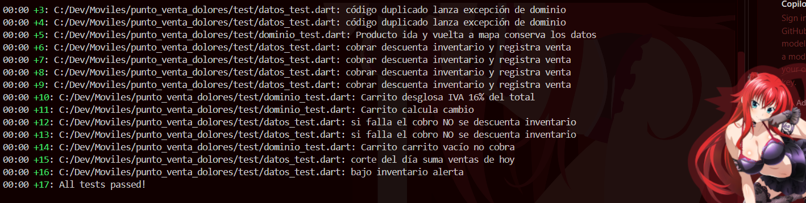

---

## 📱 Capturas de la Aplicación en Ejecución

### Pantalla Principal / Funcionamiento de la App

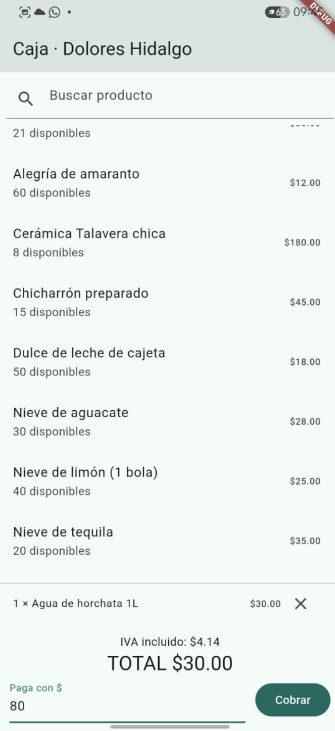

### Venta Cobrada / Detalle de Operación

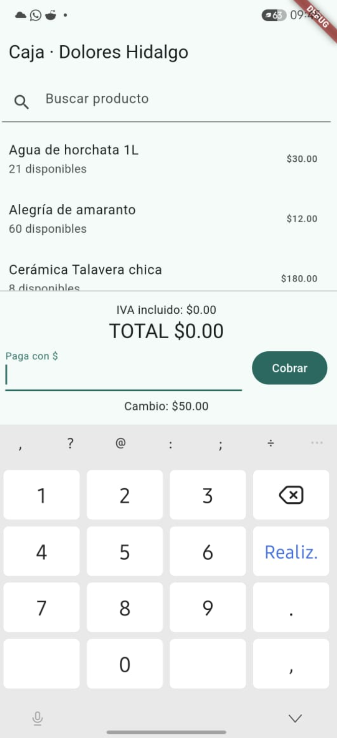